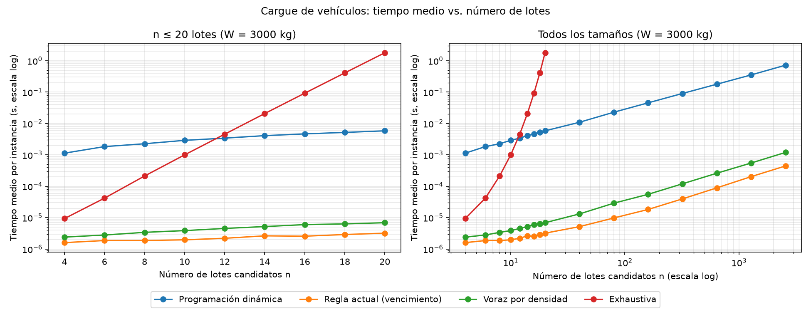
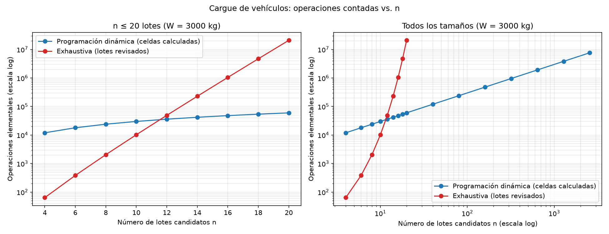
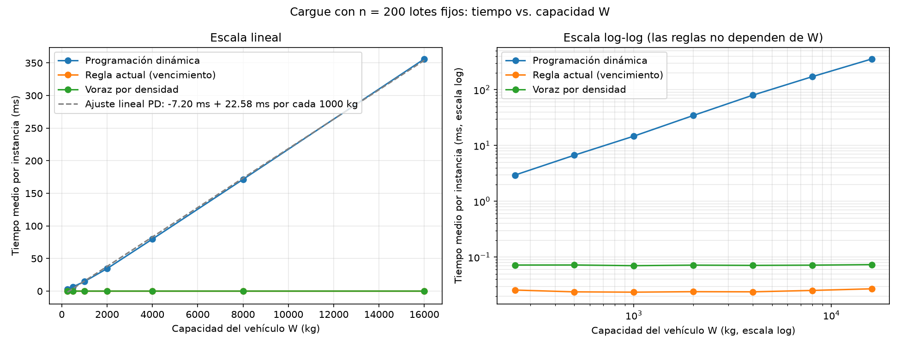

# Proyecto final — Caso 3: Banco Regional de Alimentos

**Curso:** Análisis de Algoritmos 190304006-1 — ITM, periodo 2026-2
**Caso asignado:** Caso 3 — Banco Regional de Alimentos
**Integrantes:**

* Samuel Cristobal Cuello Duque
* Daniel Felipe Marin Marin
* Tomas Gonzalez Zapata
* Carolina Arango Escobar

| Entrega | Fecha | Alcance |
| --- | --- | --- |
| Laboratorio 4 (15 %) | Miércoles 18 de noviembre de 2026 | Operación 3 — Cargue de los vehículos (programación dinámica) |
| Proyecto final (20 %) | Lunes 23 de noviembre de 2026 | Operación 4 — Saturación de la bodega, análisis del proceso completo, implicaciones e informe en PDF |

---

# 1. Análisis del problema

## 1.1 Descripción del problema computacional

**Pendiente para la entrega del 23 de noviembre.**

## 1.2 Operaciones críticas del proceso

**Pendiente para la entrega del 23 de noviembre.**

## 1.3 Costo energético del proceso actual (línea base)

**Pendiente para la entrega del 23 de noviembre.**

## 1.4 Operación 3 — Cargue de los vehículos: entradas, salida y restricciones

Para cada ruta hay que escoger qué lotes candidatos suben al vehículo para que el valor nutricional transportado sea el máximo sin superar su capacidad. El tamaño de la entrada es **n**, el número de lotes candidatos; como se verá, el costo depende también de la capacidad **W**.

| Elemento | Descripción |
| --- | --- |
| Entradas | `lotes`: lista de n lotes `(peso_kg, valor_nutricional, dias_para_vencer)`. El peso es un entero en kilogramos; el valor son las raciones del lote ponderadas por la prioridad de su categoría (proteína, frutas y verduras, otros). `capacidad_kg`: capacidad W del vehículo, entera, en kilogramos. |
| Volumen real | 14 vehículos de 2.500 a 4.000 kg; cada ruta tiene entre 300 y 600 lotes candidatos. |
| Salida | El valor nutricional máximo y los índices de los lotes que suben, en orden creciente. |
| Restricciones | (1) Ningún vehículo supera su capacidad. (2) Un lote no se fracciona: sube completo o no sube. (3) El valor cargado es el **máximo**, no una aproximación. (4) Las operaciones 1 a 3 terminan en la ventana de 2 horas (03:00 – 05:00), en un computador de 150 W, sin paralelismo. (5) El registro original de cada lote no se modifica (trazabilidad sanitaria). |
| Estrategia actual | Ordenar por vencimiento y cargar hasta que el siguiente lote ya no cabe. Cuesta Θ(n log n), pero no garantiza el máximo: los vehículos salen, en promedio, al 78 % de su capacidad. |

## 1.5 Operación 4 — Saturación de la bodega: entradas, salida y restricciones

**Pendiente para la entrega del 23 de noviembre.**

## 1.6 Supuestos

### Operación 3

1. **Una ruta por vehículo y por día:** cada día hay 14 instancias independientes, una por vehículo, y los lotes candidatos de una ruta no compiten con los de otra.
2. **Los candidatos ya están vigentes:** el filtro de lotes vencidos (ningún lote vencido se despacha) se aplica antes, en las operaciones 1 y 2. Por eso `dias_para_vencer` ≥ 1.
3. **Datos enteros:** pesos enteros ≥ 1 kg, valores enteros ≥ 0 ya ponderados por la prioridad de la categoría (el banco los calcula) y capacidad entera ≥ 0, todo en kilogramos.
4. **Cómo interpretamos la regla actual:** los lotes se ordenan por `dias_para_vencer`, de menor a mayor, y a igual vencimiento por orden de llegada (su índice). Se cargan en ese orden y la regla **se detiene en el primer lote que no cabe**, aunque detrás haya lotes más livianos que sí cabrían, porque el caso dice "hasta que ya no cabe el siguiente lote". Ejemplo: con 1.000 kg y lotes de 600, 500 y 200 kg en ese orden, carga el de 600, se detiene en el de 500 y no prueba el de 200.
5. **Regla por densidad (segundo contraste):** ordena por valor por kilogramo, de mayor a menor (a igual densidad, por índice). A diferencia de la regla actual, **salta** los lotes que no caben y sigue con los demás. Nunca fracciona un lote.
6. **Desempates:** si llevar o no llevar un lote da el mismo valor, la programación dinámica no lo lleva. Por eso puede devolver un conjunto de lotes distinto al de la solución exhaustiva con el mismo valor. Las pruebas comparan valores y verifican que los lotes de cada solución respeten la capacidad y sumen el valor reportado.
7. **Ventana:** los segundos que use esta operación salen de la misma ventana de 2 horas que necesitan las operaciones 1 y 2.

### Operación 4

**Pendiente para la entrega del 23 de noviembre.**

---

# 2. Diseño de la solución

## 2.1 Estructuras de datos seleccionadas

**Pendiente para la entrega del 23 de noviembre.**

## 2.2 Operación 3: mochila 0/1 por programación dinámica

### Por qué el problema admite programación dinámica

* **La decisión** es lote por lote: ¿sube o no sube? Para escribir la recurrencia se mira siempre el **último** lote del grupo considerado.
* **Subestructura óptima.** Sea una carga óptima con los lotes 1..i y capacidad w. Si incluye el lote i, el resto de la carga debe ser una carga óptima de los lotes 1..i − 1 con capacidad w − pᵢ: si existiera una mejor para esos kilogramos, se cambiaría esa parte y el total subiría, lo que contradice que era óptima (el argumento de "cortar y pegar"). Si no lo incluye, es una carga óptima de los lotes 1..i − 1 con capacidad w.
* **Subproblemas traslapados.** El mismo par (lotes considerados, kilogramos libres) aparece por caminos distintos. En el ejemplo de abajo, K[4][500] se necesita para K[5][500] (si no se lleva L4) y para K[5][700] (si se lleva L4, que pesa 200 kg). Una búsqueda que pruebe los 2ⁿ subconjuntos recalcula esos estados una y otra vez. La tabla solo tiene (n + 1)(W + 1) estados distintos: con 600 lotes y 4.000 kg son 2,4 millones, frente a 2⁶⁰⁰ ≈ 4·10¹⁸⁰ subconjuntos.
* **Por qué no basta una regla voraz:** una regla que elige una vez y no reconsidera (por vencimiento o por densidad) puede dejar un hueco que ningún lote llena. El contraejemplo calculado está en la sección 5.1.

### La recurrencia

**K[i][w]** = el mayor valor nutricional que se logra eligiendo **solo entre los i primeros lotes** con un vehículo de **w kilogramos**. El lote i pesa pᵢ y vale vᵢ.

```text
K[0][w] = 0                                         para todo w (caso base)
K[i][w] = K[i-1][w]                                 si p_i > w  (el lote i no cabe)
K[i][w] = max( K[i-1][w],  v_i + K[i-1][w - p_i] )  si p_i <= w
```

* `K[i-1][w]`: **no subir** el lote i. La capacidad sigue siendo w y quedan los i − 1 lotes anteriores.
* `v_i + K[i-1][w - p_i]`: **subir** el lote i. Se gana vᵢ y quedan w − pᵢ kilogramos para los lotes anteriores. Solo existe si el lote cabe.
* **Caso base:** sin lotes no hay valor (fila 0 en ceros). Con w = 0 tampoco cabe nada, porque todo peso es ≥ 1.
* **Orden de llenado:** cada fila depende solo de la anterior, así que se llena **fila por fila, de arriba hacia abajo** (i = 1, …, n). Dentro de una fila el orden de las columnas no importa.
* **Respuesta:** K[n][W]. Los lotes se recuperan recorriendo la tabla desde esa casilla hacia arriba.

### Ejemplo resuelto a mano

Una camioneta de **1.000 kg** y cinco lotes candidatos (es la misma instancia del contraejemplo de la sección 5.1):

| Lote | Peso (kg) | Valor (raciones ponderadas) | Días para vencer | Valor por kg |
| --- | ---: | ---: | ---: | ---: |
| L0 | 600 | 600 | 1 | 1,00 |
| L1 | 500 | 700 | 2 | 1,40 |
| L2 | 400 | 600 | 3 | 1,50 |
| L3 | 300 | 480 | 4 | 1,60 |
| L4 | 200 | 220 | 5 | 1,10 |

Todos los pesos son múltiplos de 100 kg, así que entre una centena y la siguiente la tabla no cambia (con 650 kg se logra lo mismo que con 600). Por eso basta llenar a mano las columnas 0, 100, …, 1.000. El programa llena las 1.001 columnas y [pruebas.py](src/cargue_vehiculos/pruebas.py) verifica que coincidan con esta tabla.

| i \ w (kg) | 0 | 100 | 200 | 300 | 400 | 500 | 600 | 700 | 800 | 900 | 1.000 |
| --- | ---: | ---: | ---: | ---: | ---: | ---: | ---: | ---: | ---: | ---: | ---: |
| 0 (ninguno) | 0 | 0 | 0 | 0 | 0 | 0 | 0 | 0 | 0 | 0 | 0 |
| 1 (+L0) | 0 | 0 | 0 | 0 | 0 | 0 | 600 | 600 | 600 | 600 | 600 |
| 2 (+L1) | 0 | 0 | 0 | 0 | 0 | 700 | 700 | 700 | 700 | 700 | 700 |
| 3 (+L2) | 0 | 0 | 0 | 0 | 600 | 700 | 700 | 700 | 700 | 1.300 | 1.300 |
| 4 (+L3) | 0 | 0 | 0 | 480 | 600 | 700 | 700 | 1.080 | 1.180 | 1.300 | 1.300 |
| 5 (+L4) | 0 | 0 | 220 | 480 | 600 | 700 | 820 | 1.080 | 1.180 | 1.300 | **1.400** |

Cómo se llenan algunas casillas:

* **Fila 2 (L1: 500 kg, 700), w = 1.000:** no subir L1 da K[1][1.000] = 600; subirlo da 700 + K[1][500] = 700 + 0 = 700. Gana 700, porque L0 y L1 juntos pesan 1.100 kg y no caben.
* **Fila 3 (L2: 400 kg, 600), w = 900:** no subirlo da K[2][900] = 700; subirlo da 600 + K[2][500] = 600 + 700 = **1.300** (L1 + L2).
* **Fila 4 (L3: 300 kg, 480), w = 1.000:** no subirlo da K[3][1.000] = 1.300; subirlo da 480 + K[3][700] = 480 + 700 = 1.180. Gana 1.300: con cuatro lotes, lo mejor sigue siendo L1 + L2.

La última fila (L4: 200 kg, valor 220), con las dos opciones de cada casilla:

| w (kg) | (a) No subir L4: K[4][w] | (b) Subir L4: 220 + K[4][w − 200] | K[5][w] |
| ---: | ---: | ---: | ---: |
| 0 – 100 | 0, 0 | no cabe | 0, 0 |
| 200 | 0 | 220 + K[4][0] = 220 | 220 |
| 300 | 480 | 220 + K[4][100] = 220 | 480 |
| 400 | 600 | 220 + K[4][200] = 220 | 600 |
| 500 | 700 | 220 + K[4][300] = 700 | 700 (empate: no lo sube) |
| 600 | 700 | 220 + K[4][400] = 820 | 820 |
| 700 | 1.080 | 220 + K[4][500] = 920 | 1.080 |
| 800 | 1.180 | 220 + K[4][600] = 920 | 1.180 |
| 900 | 1.300 | 220 + K[4][700] = 1.300 | 1.300 (empate: no lo sube) |
| 1.000 | 1.300 | 220 + K[4][800] = **1.400** | **1.400** |

La casilla final muestra por qué hace falta la tabla: subir L4 solo conviene porque K[4][800] = 1.180 ya sabía que L1 y L3 caben juntos en 800 kg.

### Reconstrucción de la carga

Se parte de K[5][1.000] y se sube una fila por lote. Si la casilla cambió respecto a la fila de arriba, el lote se subió y la capacidad baja lo que pesa:

1. Fila 5 (L4), w = 1.000: K[5][1.000] = 1.400 ≠ K[4][1.000] = 1.300, así que **L4 sube**. Quedan 800 kg.
2. Fila 4 (L3), w = 800: K[4][800] = 1.180 ≠ K[3][800] = 700, así que **L3 sube**. Quedan 500 kg.
3. Fila 3 (L2), w = 500: K[3][500] = 700 = K[2][500] = 700, así que L2 no sube.
4. Fila 2 (L1), w = 500: K[2][500] = 700 ≠ K[1][500] = 0, así que **L1 sube**. Quedan 0 kg.
5. Fila 1 (L0), w = 0: K[1][0] = 0 = K[0][0], así que L0 no sube.

**Carga óptima: L1, L3 y L4**, con 500 + 300 + 200 = 1.000 kg (100 % de la capacidad) y un valor de 700 + 480 + 220 = **1.400**. La solución exhaustiva revisa los 2⁵ = 32 subconjuntos y llega al mismo valor.

### Estrategias de contraste

```text
EXHAUSTIVA(lotes, W):                    # la solución exacta para verificar
    mejor ← 0
    para cada x en {0,1}^n:              # 2^n subconjuntos
        peso ← Σ x_i·p_i ; valor ← Σ x_i·v_i      # revisa los n lotes
        si peso ≤ W y valor > mejor: mejor ← valor; guardar x
    devolver mejor y los i con x_i = 1

POR_VENCIMIENTO(lotes, W):               # la regla actual
    ordenar los lotes por días para vencer (a igual fecha, por llegada)
    para cada lote en ese orden:
        si no cabe: DETENERSE
        subirlo

POR_DENSIDAD(lotes, W):                  # la voraz tentadora
    ordenar los lotes por valor/peso, de mayor a menor
    para cada lote en ese orden:
        si cabe: subirlo                 # si no cabe, lo salta y sigue
```

### Cómo reduce el consumo energético

En cómputo puro, la regla actual ya es barata (Θ(n log n)), y la programación dinámica gasta más: unos 2 segundos al día (sección 4.1.7). Pero la restricción del caso exige el **máximo**, y la única otra forma de garantizarlo, la exhaustiva, no terminaría nunca: con 300 lotes tardaría más de 10⁷⁸ años por ruta. La programación dinámica es la estrategia que cumple la restricción con un consumo despreciable (0,024 kWh al año, sección 6.1).

El ahorro que importa está en el alimento. En los datos sintéticos, los mismos 14 viajes pasan de llevar el 81 % de la capacidad a llevar el 99,96 %, unos 8.381 kg más por día. Eso significa menos alimento que se vence en la bodega (2,5 kg de CO₂e por kilogramo desechado, según el banco) y menos combustible por kilogramo entregado.

## 2.3 Operación 4: tramo de mayor crecimiento del inventario

**Pendiente para la entrega del 23 de noviembre.**

---

# 3. Implementación

## 3.1 Tecnologías y herramientas

* **Python 3.14.7**, solo con la biblioteca estándar en las soluciones: `itertools.product` (subconjuntos de la exhaustiva), `random` (datos con semilla fija), `time.perf_counter` (cronómetro), `statistics`, `math` y `pathlib`. No se usan bibliotecas de optimización ni de mochila.
* **matplotlib 3.11.1** para las gráficas, registrado con sus dependencias en [requirements.txt](requirements.txt).
* **Git y GitHub** para el trabajo en equipo; cada integrante sube sus aportes con su cuenta.
* **Equipo de medición:** AMD Ryzen 5 4600H, 15,4 GB de RAM, Windows 11, con las demás aplicaciones cerradas.

## 3.2 Operación 3 — Cargue de los vehículos

**Código:** [estrategia.py](src/cargue_vehiculos/estrategia.py) · [exhaustivo.py](src/cargue_vehiculos/exhaustivo.py) · [regla_actual.py](src/cargue_vehiculos/regla_actual.py) · [pruebas.py](src/cargue_vehiculos/pruebas.py)

* [estrategia.py](src/cargue_vehiculos/estrategia.py): `llenar_tabla` llena K fila por fila, `reconstruir_lotes` recorre la tabla hacia arriba y `cargar_vehiculo` (la firma del enunciado) devuelve `(valor, índices)`.
* [exhaustivo.py](src/cargue_vehiculos/exhaustivo.py): `cargar_exhaustivo` recorre los 2ⁿ vectores de `product([0, 1], repeat=n)` y se queda con el primer subconjunto de mayor valor que cabe.
* [regla_actual.py](src/cargue_vehiculos/regla_actual.py): `cargar_por_vencimiento` (la regla actual, que se detiene en el primer lote que no cabe) y `cargar_por_densidad` (que salta los que no caben).

**Decisiones de implementación:**

* **Las firmas y los docstrings del enunciado no cambian.** Para contar operaciones, cada solución tiene una variante `..._contando` que devuelve además el conteo, y la función del enunciado la llama y descarta ese número. Así lo que se cronometra es exactamente el mismo código que se cuenta. El contador de la programación dinámica suma W + 1 una vez por fila (n sumas en total, frente a n·W celdas), así que no altera el tiempo.
* **La tabla completa se guarda** porque la reconstrucción la necesita. La fila anterior y la actual se toman en variables locales (`anterior`, `actual`) para no indexar dos veces por celda.
* **La capacidad va en kilogramos, como la da el caso.** Expresarla en gramos multiplicaría el número de columnas por 1.000 sin cambiar la respuesta (sección 4.1.1).
* **Ninguna función modifica la lista de lotes**, y los índices se devuelven en orden creciente. Las reglas ordenan una lista de índices, no los lotes.
* **Desempates documentados** (sección 1.6): la programación dinámica no sube un lote si empata; la exhaustiva conserva el primer subconjunto que encuentra; las reglas desempatan por orden de llegada.

## 3.3 Operación 4 — Saturación de la bodega

**Pendiente para la entrega del 23 de noviembre.**

---

# 4. Evaluación del desempeño

## 4.1 Operación 3 — Cargue de los vehículos

### 4.1.1 Complejidad temporal y espacial

| Solución | Tiempo | Memoria extra | De dónde sale |
| --- | --- | --- | --- |
| Programación dinámica | **Θ(n·W)** | Θ(n·W) | (n + 1)(W + 1) celdas, cada una con una comparación Θ(1); la reconstrucción suma Θ(n). La tabla completa ocupa (n + 1)(W + 1) enteros. |
| Exhaustiva | **Θ(n·2ⁿ)** | Θ(n) | 2ⁿ subconjuntos, y en cada uno se revisan los n lotes. |
| Regla actual (vencimiento) | Θ(n log n) | Θ(n) | Ordenar los índices cuesta Θ(n log n) y el recorrido Θ(n). |
| Voraz por densidad | Θ(n log n) | Θ(n) | Igual que la anterior. Ninguna de las dos depende de W. |

**El costo de la programación dinámica depende de W, no solo de n.** Θ(n·W) es **pseudo-polinomial**: crece con el *valor* de la capacidad, no con las cifras que se necesitan para escribirla. Con la misma ruta de 600 lotes, pasar de W = 4.000 kg a W = 4.000.000 g solo agrega tres cifras al dato, pero multiplica la tabla por 1.000 (de 2,4 millones a 2.400 millones de celdas). Con el volumen real la tabla es pequeña: 600 × 4.001 ≈ 2,4 millones de celdas por ruta, que según `tracemalloc` ocupan **21,7 MiB** en el peor caso (40,3 MiB con 1.200 lotes y 83,7 MiB si además W = 8.000 kg). La exhaustiva, en cambio, tendría que revisar 600 × 2⁶⁰⁰ ≈ 2,5·10¹⁸³ lotes.

### 4.1.2 Verificación

[pruebas.py](src/cargue_vehiculos/pruebas.py) es un script con `assert` que prueba las cuatro soluciones:

| Caso | Qué se comprueba |
| --- | --- |
| Sin lotes | Las cuatro devuelven `(0, [])` |
| Capacidad 0 | `(0, [])` con los lotes del ejemplo |
| Un solo lote | Si cabe, `(450, [0])`; si no cabe, `(0, [])` |
| Ningún lote cabe | Tres lotes de 1.100 a 2.000 kg en 1.000 kg: `(0, [])` |
| Todo cabe y llenado exacto | Las cuatro cargan todo: `(1250, [0, 1, 2])` y `(1200, [0, 1])` |
| Solo cabe un lote a la vez | La PD, la exhaustiva y la densidad eligen el de valor 900; la regla actual se queda con el primero que vence (500) |
| Ejemplo a mano (sección 2.2) | `cargar_vehiculo` y `cargar_exhaustivo` dan `(1400, [1, 3, 4])`; las 66 casillas de la tabla a mano coinciden con `llenar_tabla`, y cada columna intermedia repite la de su centena |
| Contraejemplo (sección 5.1) | La regla actual da `(600, [0])` y la de densidad `(1300, [2, 3, 4])`, ambas menores que 1.400 |
| 30 instancias aleatorias pequeñas (semilla 2026) | n de 0 a 12, pesos de 1 a 20 kg, valores de 1 a 50, W de 0 a 60: la PD y la exhaustiva dan **el mismo valor** |
| 10 instancias con el generador de la medición | n de 1 a 12 y W de 1.000 a 4.000 kg: la PD y la exhaustiva dan el mismo valor |
| Restricción del negocio (en todas las instancias y las cuatro soluciones) | Peso cargado ≤ W; índices únicos, ordenados y en rango, es decir, cada lote sube completo y una sola vez (no se fracciona ni se repite); suma de valores = valor devuelto; ninguna regla supera el óptimo; la regla actual carga un prefijo del orden por vencimiento y el siguiente lote no cabe; todo lote que deja la densidad pesa más de lo que quedó libre; la lista de entrada no cambia |

Salida:

```text
Todas las pruebas pasaron (40 instancias aleatorias con semilla 2026).
La regla por vencimiento quedo por debajo del optimo en 20 de 40 instancias y la regla por densidad en 7 de 40.
```

Además, [medicion.py](src/cargue_vehiculos/medicion.py) vuelve a comparar la PD con la exhaustiva **dentro del experimento**: en cada instancia de n = 4 a 20 lanza `ValueError` si los valores no coinciden. En las 27 instancias coincidieron.

### 4.1.3 Cómo se midió

**Código:** [datos.py](src/cargue_vehiculos/datos.py) · [medicion.py](src/cargue_vehiculos/medicion.py)

* **Datos sintéticos** ([datos.py](src/cargue_vehiculos/datos.py)): el 60 % de los lotes son grandes (de 500 a 2.000 kg, una o varias estibas) y el 40 % son cajas (de 10 a 150 kg). El valor es peso × (1 a 3 raciones por kg) × la prioridad de la categoría (proteína 3, frutas y verduras 2, otros 1, con probabilidades de 25, 35 y 40 %). El vencimiento va de 1 a 20 días.
* **Calibración con el dato del cliente:** la proporción y el peso de los lotes grandes se ajustaron para que la regla actual llene en promedio cerca del **78 %** del vehículo, la cifra que reporta el banco. Con 600 rutas de prueba dio entre 78,4 % y 79,1 %; en las 70 rutas del experimento 4 dio 81,1 %.
* **Semilla fija** `random.Random(2026)` (2027, 2028 y 2029 en los experimentos 2 a 4). En cada tamaño, **todas las soluciones reciben las mismas instancias**.
* **Cronómetro:** `time.perf_counter()` solo alrededor de la llamada a cada solución; los datos se generan antes. Cada instancia se mide 5 veces (3 en la exhaustiva y en el experimento 4) y se toma la mediana. El tiempo reportado es la **media sobre 3 instancias** por tamaño.
* **Operaciones contadas:** las celdas que calcula la PD y los lotes que revisa la exhaustiva (n por subconjunto), con los contadores de las funciones `..._contando`.
* **Cuatro experimentos:**

| Experimento | Tamaños | Soluciones |
| --- | --- | --- |
| 1. n pequeño, W = 3.000 kg fija | n = 4, 6, …, 20 (9 tamaños; 4→8, 6→12, 8→16 y 10→20 duplican n) | Las cuatro |
| 2. n grande, W = 3.000 kg fija | n = 40, 80, …, 2.560 (cada uno el doble del anterior) | PD y reglas (la exhaustiva ya no termina) |
| 3. n = 200 fijo, W creciente | W = 250, 500, …, 16.000 kg (cada una el doble) | PD y reglas |
| 4. Volumen real | 5 días × 14 rutas con 300 a 600 lotes y W de 2.500 a 4.000 kg | PD y reglas; también llenado y valor |

`medicion.py` tarda unos 2 minutos e imprime todas las tablas, factores, pendientes y estimaciones que se citan abajo.

### 4.1.4 Resultados

**Experimento 1** (n pequeño, W = 3.000 kg):

| n | PD (ms) | Exhaustiva (ms) | Regla actual (ms) | Densidad (ms) | Celdas PD | Lotes revisados por la exhaustiva |
| ---: | ---: | ---: | ---: | ---: | ---: | ---: |
| 4 | 1,135 | 0,009 | 0,0016 | 0,0024 | 12.004 | 64 |
| 6 | 1,837 | 0,042 | 0,0019 | 0,0028 | 18.006 | 384 |
| 8 | 2,265 | 0,212 | 0,0019 | 0,0034 | 24.008 | 2.048 |
| 10 | 2,907 | 1,001 | 0,0020 | 0,0039 | 30.010 | 10.240 |
| 12 | 3,419 | 4,556 | 0,0022 | 0,0045 | 36.012 | 49.152 |
| 14 | 4,106 | 20,724 | 0,0026 | 0,0052 | 42.014 | 229.376 |
| 16 | 4,668 | 92,472 | 0,0026 | 0,0060 | 48.016 | 1.048.576 |
| 18 | 5,203 | 409,408 | 0,0029 | 0,0063 | 54.018 | 4.718.592 |
| 20 | 5,847 | 1.796,571 | 0,0032 | 0,0069 | 60.020 | 20.971.520 |

**Experimento 2** (n grande, W = 3.000 kg):

| n | PD (ms) | Regla actual (ms) | Densidad (ms) | Celdas PD | ns por celda |
| ---: | ---: | ---: | ---: | ---: | ---: |
| 40 | 10,95 | 0,0052 | 0,0131 | 120.040 | 91,2 |
| 80 | 22,89 | 0,0098 | 0,0289 | 240.080 | 95,3 |
| 160 | 45,62 | 0,0183 | 0,0555 | 480.160 | 95,0 |
| 320 | 90,79 | 0,0397 | 0,1201 | 960.320 | 94,5 |
| 640 | 179,11 | 0,0892 | 0,2610 | 1.920.640 | 93,3 |
| 1.280 | 354,15 | 0,2033 | 0,5528 | 3.841.280 | 92,2 |
| 2.560 | 723,88 | 0,4454 | 1,2029 | 7.682.560 | 94,2 |





**Experimento 3** (n = 200 lotes fijos, W creciente):

| W (kg) | PD (ms) | Regla actual (ms) | Densidad (ms) | Celdas PD | ns por celda |
| ---: | ---: | ---: | ---: | ---: | ---: |
| 250 | 2,95 | 0,0257 | 0,0721 | 50.200 | 58,8 |
| 500 | 6,71 | 0,0238 | 0,0723 | 100.200 | 67,0 |
| 1.000 | 14,72 | 0,0235 | 0,0702 | 200.200 | 73,5 |
| 2.000 | 34,56 | 0,0240 | 0,0718 | 400.200 | 86,4 |
| 4.000 | 79,85 | 0,0239 | 0,0710 | 800.200 | 99,8 |
| 8.000 | 171,44 | 0,0253 | 0,0718 | 1.600.200 | 107,1 |
| 16.000 | 356,11 | 0,0270 | 0,0734 | 3.200.200 | 111,3 |



### 4.1.5 Lo medido contra lo esperado

**Al duplicar n** (los factores los calcula `medicion.py`):

| Pareja n → 2n | PD | Θ(n·W) predice | Exhaustiva | Θ(n·2ⁿ) predice | Regla actual | Densidad |
| --- | ---: | ---: | ---: | ---: | ---: | ---: |
| 4 → 8 | ×2,00 | ×2 | ×22,7 | ×32 | ×1,17 | ×1,42 |
| 6 → 12 | ×1,86 | ×2 | ×108,9 | ×128 | ×1,18 | ×1,62 |
| 8 → 16 | ×2,06 | ×2 | ×435,9 | ×512 | ×1,37 | ×1,76 |
| 10 → 20 | ×2,01 | ×2 | ×1.795,4 | ×2.048 | ×1,63 | ×1,78 |
| 640 → 1.280 | ×1,98 | ×2 | — | — | ×2,28 | ×2,12 |
| 1.280 → 2.560 | ×2,04 | ×2 | — | — | ×2,19 | ×2,18 |

* **Programación dinámica frente a n:** con W fija, al duplicar n el tiempo se multiplica entre ×1,86 y ×2,09 en los diez pares medidos, y las celdas exactamente ×2,00. La pendiente log-log del experimento 2 es **1,001** (1 = lineal) y el costo por celda se mantiene entre 91 y 95 ns. Coincide con Θ(n·W).
* **Exhaustiva:** las operaciones contadas se multiplican exactamente por 2ⁿ·2 (×32, ×128, ×512 y ×2.048). El tiempo se queda algo por debajo en tamaños pequeños (×22,7 frente a ×32), porque el costo fijo de cada llamada pesa más cuando hay pocos subconjuntos, y se acerca al esperado al crecer n (×1.795 frente a ×2.048). Con dos lotes más el tiempo se multiplica por ×4,39 de 18 a 20 lotes (se esperaba 4 × 20/18 = ×4,44). En la gráfica semilogarítmica la curva es una recta: log₂(tiempo) crece **1,099 por lote**, es decir, cada lote adicional multiplica el tiempo por ×2,14.
* **Cruce:** con 10 lotes la exhaustiva todavía gana (1,0 ms frente a 2,9 ms), porque la tabla de 3.001 columnas tiene un costo fijo. Desde 12 lotes gana la PD, y con 20 lotes es **307 veces** más rápida (1.796,6 ms frente a 5,8 ms).
* **Programación dinámica frente a W (experimento 3):** al duplicar W las celdas se duplican exactamente, pero el tiempo se multiplica entre ×2,08 y ×2,35 y la pendiente log-log es **1,162**, no 1. La diferencia está en el costo por celda, que sube de 58,8 ns (W = 250) a 111,3 ns (W = 16.000). Cada fila tiene W + 1 referencias: con W = 16.000, dos filas ya no caben en la caché del procesador, mientras que con W = 3.000 (experimento 2) sí caben y el costo por celda no cambia. El ajuste lineal −7,20 ms + 22,58 ms por cada 1.000 kg (gráfica, panel izquierdo) tiene un intercepto negativo por esa curvatura leve. La conclusión de la guía se confirma con datos: **el costo depende de W**, y con 200 lotes pasar de 1.000 a 16.000 kg multiplica el tiempo por 24.
* **Reglas voraces:** Θ(n log n) predice algo más que ×2 al duplicar n (2·log₂ 2.560 / log₂ 1.280 = ×2,19). La regla actual dio ×2,19 y la densidad ×2,18 en ese par, con pendientes log-log de 1,083 y 1,082. Frente a W, sus pendientes son **0,015 y 0,003**: no dependen de la capacidad. Con n ≤ 20 crecen menos que ×2 porque domina un costo fijo de unos 2 µs.

### 4.1.6 Calidad de la carga con el volumen real

Experimento 4: 5 días simulados × 14 rutas reales, es decir, 70 rutas con 300 a 600 lotes y vehículos de 2.500 a 4.000 kg.

| Solución | Tiempo medio por día (s) | Tiempo máximo por día (s) | Llenado medio | Valor medio (% del óptimo) | Peor ruta (% del óptimo) | kg cargados por día |
| --- | ---: | ---: | ---: | ---: | ---: | ---: |
| Programación dinámica | 1,9197 | 2,0635 | 99,96 % | 100 % | 100 % | 45.117 |
| Regla actual (vencimiento) | 0,0009 | 0,0009 | 81,11 % | 35,20 % | 10,2 % | 36.736 |
| Voraz por densidad | 0,0026 | 0,0027 | 99,86 % | 99,48 % | 97,43 % | 45.073 |

* La regla actual deja en promedio el **19 %** del vehículo vacío (en una ruta llenó solo el 48,7 %) y logra apenas el **35 %** del valor nutricional posible: carga lo que vence primero, sin mirar cuánto aporta. La PD lleva **8.381 kg más por día** en los mismos 14 viajes y **2,8 veces** más valor.
* La voraz por densidad se acerca mucho (99,48 % del valor en promedio), pero **no llegó al óptimo en 62 de las 70 rutas**: no cumple la restricción del máximo. Con lotes pequeños frente a la capacidad, el hueco que deja suele ser pequeño. Con lotes grandes puede ser mucho mayor (−7,1 % en el contraejemplo).
* Estas cifras salen de datos sintéticos calibrados con el 78 % del cliente. La magnitud real de la ganancia en valor depende de cuánto varíe el valor por kilogramo entre los lotes del banco.

### 4.1.7 Extrapolación al volumen real y ventana operativa

* **Programación dinámica:** el tiempo es proporcional al número de celdas (pendiente 1,001 frente a n y costo casi constante por celda), así que se extrapola por celdas y no con una regla de tres sobre una sola medición. Con n ≥ 320 y W ≥ 1.000 el costo por celda medido va de **73,5 a 111,3 ns**. El peor día real (14 rutas × 600 lotes × 4.001 columnas = 33,6 millones de celdas) tomaría **entre 2,47 y 3,74 s**.
* **Validación de la extrapolación:** para el día medio simulado (20,1 millones de celdas) el mismo cálculo predice entre 1,48 y 2,24 s, y la medición directa dio **1,92 s**, dentro del rango. Por eso la estimación es confiable para este equipo.
* **Ventana:** las 2 horas son 7.200 s. La PD usa el **0,027 %** de la ventana en el día medio y el 0,052 % en el peor día; deja prácticamente toda la ventana para las operaciones 1 y 2. Las reglas usan menos de 3 ms por día.
* **Exhaustiva:** cuesta 85,7 ns por lote revisado (n = 20). Con 300 lotes serían 300 × 2³⁰⁰ revisiones: **1,7·10⁷⁸ años por ruta**, 1,2·10⁶⁸ veces la edad del universo; con 600 lotes, 6,8·10¹⁶⁸ años. **No terminaría nunca.** Aquí no sirve una regla de tres: cada lote adicional duplica el tiempo. En la ventana de 2 horas, la exhaustiva solo alcanzaría para rutas de **27 lotes**, frente a los 300 a 600 reales.

## 4.2 Operación 4 — Saturación de la bodega

**Pendiente para la entrega del 23 de noviembre.**

---

# 5. Análisis comparativo

## 5.1 Operación 3 — Cargue de los vehículos

### Contraejemplo calculado: por qué fallan la regla actual y la regla por densidad

Instancia: la del ejemplo a mano (sección 2.2), una camioneta de 1.000 kg con L0 (600 kg, 600, vence en 1 día), L1 (500, 700, 2), L2 (400, 600, 3), L3 (300, 480, 4) y L4 (200, 220, 5).

| Estrategia | Lotes cargados | Peso | Valor | Diferencia con el óptimo |
| --- | --- | ---: | ---: | ---: |
| Programación dinámica (óptimo) | L1, L3, L4 | 1.000 kg (100 %) | **1.400** | — |
| Regla actual: por vencimiento | L0 | 600 kg (60 %) | 600 | **−800 (−57,1 %)** |
| Regla tentadora: por densidad | L2, L3, L4 | 900 kg (90 %) | 1.300 | **−100 (−7,1 %)** |

* **Por vencimiento:** sube L0 (vence mañana, 600 kg). El siguiente, L1 (500 kg), ya no cabe (1.100 kg) y la regla **se detiene**. El vehículo sale con 400 kg libres, aunque L2, L3 o L4 cabían. Es el mismo síntoma que reporta el banco: vehículos que salen al 78 %.
* **Por densidad:** sube L3 (1,60 por kg) y L2 (1,50), con 700 kg. L1 (1,40) no cabe y lo salta; L4 (1,10) sí cabe, con 900 kg en total. Quedan **100 kg que ningún lote llena**. El óptimo renuncia a L2, el segundo lote más denso, para que L1, L3 y L4 llenen exactamente los 1.000 kg. Una regla que elige una vez y no reconsidera no puede ver ese intercambio.
* **No es un caso aislado:** en las 40 instancias aleatorias de las pruebas, la regla actual quedó por debajo del óptimo en 20 y la de densidad en 7. Con el volumen real sintético, la densidad no llegó al óptimo en 62 de 70 rutas, y la regla actual logró en promedio el 35 % del valor (sección 4.1.6). Que una regla acierte en algunas instancias no prueba que sea correcta.

### Condición contraria: cuándo bastaría una estrategia voraz

* **Si los lotes se pudieran fraccionar** (por ejemplo, granos a granel que se despachan por kilo), el problema sería la mochila fraccionaria. Ahí la voraz por densidad **sí es óptima**: sube los lotes de mayor valor por kilogramo y parte el último, en Θ(n log n). En el ejemplo subiría L3, L2 y 300 kg de L1: 480 + 600 + 420 = 1.500. En el banco eso no es posible: cada lote tiene un código, sube completo o no sube, y partirlo rompería la trazabilidad sanitaria.
* **Si todos los lotes pesaran lo mismo** (estibas estándar), bastaría una voraz por valor: subir los ⌊W/p⌋ lotes más valiosos.
* **Si la capacidad nunca fuera una limitación** (todo cabe), cualquier regla cargaría todo.

En el caso real los lotes son indivisibles y de pesos muy distintos, así que hace falta la programación dinámica.

### Ventajas y limitaciones

| Criterio | Programación dinámica | Exhaustiva | Regla actual (vencimiento) | Voraz por densidad |
| --- | --- | --- | --- | --- |
| Garantiza el máximo | **Sí** | Sí | No | No |
| Tiempo por día (volumen real) | 1,92 s (≤ 3,74 s en el peor día) | No termina | 0,9 ms | 2,6 ms |
| Complejidad | Θ(n·W) | Θ(n·2ⁿ) | Θ(n log n) | Θ(n log n) |
| ¿Depende de W? | Sí, linealmente | No | No | No |
| Memoria | Θ(n·W): 21,7 MiB por ruta | Θ(n) | Θ(n) | Θ(n) |
| Llenado medio / valor medio (sintético) | 99,96 % / 100 % | — | 81,11 % / 35,20 % | 99,86 % / 99,48 % |
| Uso razonable | Producción | Solo verificar en tamaños pequeños | Línea base | Respaldo si algún día la PD no cupiera |

### Recomendación para la Dirección de Operaciones

**Adoptar la programación dinámica (`cargar_vehiculo`) para el cargue de los vehículos.**

* **Qué gana frente a hoy:** cumple la restricción del caso (valor máximo sin superar la capacidad, verificado contra la solución exacta). En los datos sintéticos, los vehículos pasan de salir al 81 % de su capacidad a salir al 99,96 %: 8.381 kg más de alimento por día en los mismos 14 viajes, con 2,8 veces el valor nutricional. Todo eso con unos 2 segundos de cómputo por día, el 0,03 % de la ventana.
* **Riesgos y límites que debe conocer:**
  1. **El costo crece con la capacidad W, no solo con los lotes.** Vehículos más grandes o una unidad más fina (gramos) multiplican el tiempo y la memoria en la misma proporción. La capacidad debe seguir en kilogramos.
  2. **La memoria es Θ(n·W):** 21,7 MiB por ruta hoy, y más de 80 MiB con el doble de lotes y vehículos de 8.000 kg. Si crece, se puede guardar una sola fila y una tabla de bits de decisión.
  3. **La programación dinámica no mira el vencimiento.** En el ejemplo deja en la bodega a L0, que vence mañana. Si el banco no quiere que eso pase, debe decidir cómo pesa la urgencia: incluirla en el valor del lote o subir primero, como obligatorios, los lotes que vencen en 24 horas y aplicar la PD a la capacidad que quede.
  4. Esta operación **no resuelve sola la ventana de 2 horas**: casi todo el tiempo de la planeación está en las operaciones 1 y 2.

## 5.2 Operación 4 — Saturación de la bodega

**Pendiente para la entrega del 23 de noviembre.**

## 5.3 Comparación entre las operaciones y solución recomendada

**Pendiente para la entrega del 23 de noviembre.**

---

# 6. Implicaciones éticas, sociales y ambientales

## 6.1 Consumo energético

### Operación 3 — regla actual frente a programación dinámica

Energía = 0,15 kW × tiempo en horas. Los tiempos por día son los medidos con el volumen real (sección 4.1.6), y el año tiene 300 días de operación. Son **estimaciones** para este equipo, apoyadas en esas mediciones.

| Solución | Tiempo por día | kWh por día | kWh por año |
| --- | ---: | ---: | ---: |
| Regla actual (vencimiento) | 0,0009 s | 3,7·10⁻⁸ | 1,1·10⁻⁵ |
| Voraz por densidad | 0,0026 s | 1,1·10⁻⁷ | 3,2·10⁻⁵ |
| Programación dinámica (día medio, medido) | 1,92 s | 8,0·10⁻⁵ | **0,024** |
| Programación dinámica (peor día, estimado) | 3,74 s | 1,6·10⁻⁴ | 0,047 |
| Exhaustiva | No termina | — | — |

* **Diferencia a un año:** la programación dinámica consume **0,024 kWh más al año** que la regla actual (0,047 kWh en el peor caso). Es lo mismo que el computador de 150 W encendido unos 10 minutos en todo el año. Con 0,220 kg CO₂e por kWh, son unos 5 g de CO₂e al año.
* La única otra forma de garantizar el máximo, la exhaustiva, no terminaría, así que su consumo no tiene límite.
* **El balance ambiental lo decide el alimento, no el computador.** La PD lleva unas 2.514 t más de alimento al año en los mismos viajes (8.381 kg por día × 300 días, en datos sintéticos). Si apenas el 1 % de ese alimento se hubiera vencido en la bodega, se evitarían unas 25 t de desperdicio y **≈ 63 t de CO₂e al año** (2,5 kg de CO₂e por kilogramo, dato del banco), millones de veces más que los 5 g que agrega el cómputo.

### Operación 4 y proceso completo

**Pendiente para la entrega del 23 de noviembre.**

## 6.2 Personas: quién asume el costo cuando el algoritmo se equivoca o llega tarde

**Pendiente para la entrega del 23 de noviembre.**

## 6.3 Marco normativo y buenas prácticas

**Pendiente para la entrega del 23 de noviembre.**

## 6.4 Crecimiento: una segunda bodega con el doble de lotes y de vehículos

**Pendiente para la entrega del 23 de noviembre.**

---

# 7. Conclusiones

**Pendiente para la entrega del 23 de noviembre.**

---

# 8. Reproducción

Requisitos: Python 3 y las dependencias de [requirements.txt](requirements.txt) (matplotlib). Desde la raíz del repositorio se crea y se activa el entorno virtual:

```bash
python -m venv .venv
```

En Git Bash:

```bash
source .venv/Scripts/activate
```

En Windows PowerShell:

```powershell
.venv\Scripts\Activate.ps1
```

Después se instalan las dependencias:

```bash
python -m pip install -r requirements.txt
```

**Operación 3 — Cargue de los vehículos** (los datos sintéticos se generan dentro de los scripts, con semilla fija):

```bash
cd src/cargue_vehiculos
python pruebas.py
python medicion.py
```

`pruebas.py` tarda menos de un segundo. `medicion.py` tarda unos 2 minutos, imprime todas las tablas y estimaciones de la sección 4.1 y guarda `tiempo_vs_n.png`, `operaciones_vs_n.png` y `tiempo_vs_capacidad.png` en `graficas/cargue_vehiculos/`.

---

# Referencias

**Pendiente para la entrega del 23 de noviembre.**
